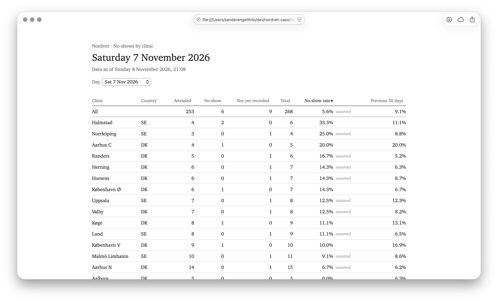

# Nordvet no-show pipeline (first slice)

A first working version of the no-show view for Nordvet's Head of Operations, built on the VetOne API.
Runs locally for the demo; the README section "Where it would run for Nordvet" describes the production setup.

The dashboard opens on the latest day with appointments (normally yesterday) and lists every clinic with that day's no-show rate next to its rate over the previous 30 days; earlier days are in a dropdown.



## Requirements
- Python 3.10+
- Docker Desktop (on Apple Silicon: enable "Use Rosetta for x86_64/amd64 emulation")
- API credentials for the VetOne API (provided separately, not part of this repo)

## Configuration
Copy the template and fill in the API credentials and a local SQL Server password:
```bash
cp .env.template .env
```
`.env` is gitignored, and Docker Compose and the pipeline both read it.

The pipeline uses the first env file it finds:
1. the path in `NORDVET_ENV_FILE`, if set;
2. `.env` in the repository root;
3. `~/.config/nordvet/.env`, outside the repository. This is for running with a coding agent that can see the repo folder, so secrets stay out of its reach. It is used only when there is no `.env` in the repo, and Docker Compose then needs `--env-file ~/.config/nordvet/.env` on every command.

## Run
Install once:
```bash
python3 -m venv .venv
.venv/bin/pip install -r requirements.txt
.venv/bin/pip install -e . --no-deps
```

Start SQL Server 2022, check the setup, run the pipeline, and open the dashboard:
```bash
docker compose up -d --wait
.venv/bin/python -m nordvet smoke
.venv/bin/python -m nordvet run --open
```

- `up -d --wait` returns once the database accepts connections (10-30 s for a fresh container under Rosetta).
- `smoke` checks the env file, that the API answers, and that the database is reachable. It does not log in to the API.
- `run` does four steps: **load** (API into `raw`, then `staging`), **build** (the `marts` views, then the build checks), **export** (Parquet files in `exports/`), and **report** (the dashboard, `reports/no-shows.html`).
  - The first run loads all history from 1 August 2026 (about 2 minutes, set by the API's rate limit). Later runs fetch only what changed, in seconds. `--full` forces a full load.
  - If the load or the build fails, the run stops. The export and the report run independently of each other.
  - `--open` opens the dashboard when it was written. `-v` gives debug logging with tracebacks.
  - Exit codes: `0` ok, `1` configuration problem, `2` a step failed. The last log line lists every step's result.
- Each step also runs on its own: `python -m nordvet.ingest.load`, `nordvet.model.build`, `nordvet.model.export`, `nordvet.report.render`.
- Tests: `.venv/bin/python -m pytest -q`. The database tests use a separate `nordvet_test` database and are skipped when SQL Server is not running.

Stop the database with `docker compose stop`; the data survives in a named volume.

## Layout
```
src/nordvet/
  pipeline.py    nordvet run: load, build, export, report
  smoke.py       nordvet smoke: setup check
  config.py      settings from the env file; secrets kept out of logs
  api/           VetOne API client: token, retries, rate limit
  ingest/        load: API pages into raw, then staging
  db/            SQL Server connection
  model/         build the marts views; Parquet export
  report/        the dashboard: generator and HTML template
sql/             T-SQL, run by the Python code in file-name order
  raw/           API responses as received, append-only
  staging/       typed, one row per appointment and clinic
  marts/         views: star schema, clinic_day, the two report views
  checks/        build checks, run on every build
tests/           pytest; database tests skip without SQL Server
exports/         generated Parquet files (not committed)
reports/         generated dashboard, no-shows.html (not committed)
```

The layers map onto medallion terms: bronze = `raw`, silver = `staging`, gold = `marts`.

## Assumptions
1. **A no-show is an appointment with status `no_show`.** Cancellations, however late, are not no-shows.
2. **No-show rate = missed ÷ (attended + missed)**, where *missed* is no-shows plus past appointments still booked (see 3). Cancelled appointments and appointments not yet due are left out, since neither could have been a no-show.
3. **Yesterday's rate is *assumed* until every outcome is recorded.** Clinics record no-shows from 08:00 the next day at the earliest, so a strict morning figure would read 0%. A past appointment still `booked` counts as missed, and the rate is marked *assumed* until it is recorded. Almost all attended visits are recorded the same day, so this runs about 0.5 percentage points high.
4. **Deleted appointments are left out.** The API keeps soft-deleted appointments; they are excluded everywhere.
5. **Figures are per clinic, not per vet.** Vets are often booked for several appointments at once, so `vet_id` may not be the vet who did the work.
6. **"Today" is each clinic's local date when the latest load started.** The same data always gives the same numbers, whenever the model is rebuilt. A clinic in a new time zone needs one line in `sql/marts/010_clinic_timezone.sql`; the build fails until it has it.
7. **The API behaves as it did during testing.** Most of its behaviour is undocumented and was found by testing. The incremental load relies on every change updating `updated_at`, which held in every comparison made. Fields or values the API adds later are ignored.

## Left out on purpose
- **Money.** The API has no price field. If Nordvet gives a price per service, a cost column is one multiplication in the SQL.
- **Cancellations on the dashboard.** Mette asked about no-shows. Cancellations are still in the model and the Parquet export.
- **Vet-level figures**, for the reason in assumption 5.
- **Real-time.** No-shows are recorded the next day, so running more often would not show today's no-shows any sooner. A daily morning run fits Mette's question. If a real same-day need comes up, an incremental run takes a few seconds, so running e.g., every 15 minutes is a schedule change, not a rebuild.
- **A built schedule.** The pipeline is ready to schedule (incremental, safe to re-run, clear exit codes), but no scheduler is set up locally; see the next section.
- **Microsoft Fabric and dbt.**
  - Fabric's cost and setup are probably not justified for 38 clinics and a team of two.
  - Plain SQL views keep everything in what Emil's team already works in; dbt is worth proposing if the models multiply.
- **Handling appointments that disappear from the API entirely.** None did while I watched. A periodic full reload would catch them.

## Where it would run for Nordvet
- **Database:** Azure SQL Database running the same T-SQL, which shouldn't need any changes.
- **Job:** the same Python, `python -m nordvet run`, as an Azure Container Apps job every morning at 07:00 (an Azure Functions timer would also work). A run takes a couple of minutes, so the page is ready before the day starts; yesterday's rates are marked *assumed* at that hour (assumption 3).
- **Secrets:** Azure Key Vault, read through a managed identity. No `.env` file.
- **Power BI:** Emil's team connects Power BI directly to the marts views in Azure SQL. Locally, the Parquet export stands in for that connection; in Azure that step is dropped.
- **The dashboard:** the generated page is saved where Mette already works, such as a SharePoint or Teams site.
- **Failures:** the job's exit code (1 for configuration, 2 for a failed run) triggers an Azure Monitor alert to Emil's team.

**I chose this setup because:**
- it costs very little (a few minutes of compute a day plus a small database)
- it's SQL and Power BI, which Emil's team already knows
- there is very little to operate

## Questions for Nordvet
- **Could no-shows be recorded the same evening?** Today they are recorded from 08:00 the next day, so the morning figure is assumed. Same-evening recording would make it confirmed.
- **Are overlapping bookings for one vet intended?** Vets are often booked for several appointments at the same time. Does `vet_id` mean the vet who does the work or the responsible vet?
- **Can `patient_ref` be linked to an owner?** If so, it may be personal data. It is kept only in `raw`, which keeps everything for now. How long should raw data be kept?
- **Is there a late-cancellation policy, such as a fee?** If so, late cancellations could become their own measure.

## How I worked on this case

Throughout this case, I have used Claude agents to write code. All design choices are my own and the agents only wrote the implementation. I never gave agents access to credentials or git; they could edit files in the repo but not delete files, commit, or push. I made every commit myself, sometimes with a message the agent suggested.

This `README` file has also been partly written by Claude based on my own decisions and reasoning. This section and "What I would do with more time" are written completely by me.

## What I would do with more time

**Simplify:** The solution is probably larger than needed for a first slice. I worked with the agent to make each part correct, but I didn't step back often enough to consider whether everything was actually necessary. With more time, I would go through it with Emil's team in mind and remove what they wouldn't miss. E.g., every build runs 13 SQL checks, maybe 2-3 of the most important ones would be enough. 

**Build closer to Nordvet's real setup:** I would have looked into actually deploying to Azure SQL with a Container Apps job, so I could test the "where it would run" section instead of just describing it. I would also have liked to compare it with Microsoft Fabric. I deliberately chose Azure SQL over Fabric because it's cheap, uses tools Emil's team already knows, and doesn't have a lot to operate, but I haven't tested that choice against Fabric.

**Improve the Power BI experience:** I currently only deliver Parquet files to Emil's IT team. With more time, I would have also pre-built a semantic model on the marts views to make it easier for the team. This would also include defining the no-show rate once so everyone at Nordvet uses the same definition. Power BI Desktop is Windows-only, so I would need to set up and use a VM on my Mac. I decided against this in the interest of time.

**Try dbt:** I have already built views, a Python build command, and checks, which is similar to what dbt provides. I purposely left dbt out of the case, but with more time I would have tried it on the same setup and compared to test whether this decision was correct. I haven't used dbt before, so this would also be a chance to learn it. I still wouldn't necessarily hand dbt to a two-person SQL team on day one.

**Analyze outlier clinics more:** I did preliminary analysis which showed that three clinics (Aarhus C, Hillerød, København V) have much higher no-show rates than what is expected from their service mixes. With more time I would have analyzed this further, e.g., by booking lead time, weekday and time of day, and the vets involved. I would also have considered whether this would be valuable to include in the dashboard for Mette, e.g., as an expected rate next to the actual one. 
